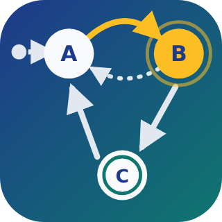

# ioBroker.statechart

[](https://www.npmjs.com/package/iobroker.statechart)
[](https://www.npmjs.com/package/iobroker.statechart)


[](https://nodei.co/npm/iobroker.statechart/)

**Tests:** 

**[English](#english) | [Deutsch](#deutsch)**

---

<a id="english"></a>

## State machine adapter for ioBroker

Model your automations as **state machines** (statecharts) in a graphical editor, similar to the
chart editors known from model based development. States, transitions with events, conditions and
actions, timers and function blocks are drawn in the ioBroker admin and executed by the adapter.

### Features

- Graphical editor as its own entry in the admin side bar
- States with `entry`, `during` and `exit` actions
- Transitions with labels in the well-known syntax `event[condition]{action}`
- Timers: `after(5, sec)`
- Function blocks with your own JavaScript functions, usable in all conditions and actions
- Inputs and outputs mapped to any ioBroker states
- Live view: the active state is highlighted in the editor, the current values of the variables are shown, taken
  transitions light up, and a history shows when which transition was taken and why
- Code editor with syntax highlighting, error checking (e.g. unknown variables) and completion
- Several independent charts per instance
- Import and export of charts as JSON files
- Comments on states, transitions and function blocks, and notes on the canvas
- Per input: wake up on every update or only on changes, filter by ack, debounce
- Helper functions: setState, setStateDelayed, sendTo, isTimeBetween, isDaytime, astroTime
- Undo/redo (Ctrl+Z, Ctrl+Y), copy/cut/paste of states and function blocks (Ctrl+C, Ctrl+X, Ctrl+V), also between charts, and a warning about unsaved changes
- **Show code**: the JavaScript generated from the chart, showing exactly how the adapter executes it

### Installation

The adapter is not in the ioBroker repositories yet, but can be installed directly from GitHub:

- **Admin:** tab **Adapters** → icon **Install from custom URL** (GitHub cat) → tab **Custom** →
  URL `https://github.com/IggePop/ioBroker.statechart` → **Install**
- **or on the console** of the ioBroker system:
  ```bash
  iobroker url https://github.com/IggePop/ioBroker.statechart
  ```

Then add an instance of **State Machine**. This installs the current development version, which may
still change incompatibly.

Requirements: Node.js 22 or newer, js-controller 6.0.11 or newer, admin 7.6.17 or newer.

### Getting started

1. Open **State Machine** in the admin side bar.
2. Create a chart with **+** in the list on the left.
3. Define the variables in the tab **Variables** on the right:
   - **Input**: read from an ioBroker state, every change wakes up the chart
   - **Output**: written to an ioBroker state when an action changes it
   - **Local**: only exists inside the chart, with an initial value
4. Add states with **Add state**. The state marked with the dot and arrow is the initial state
   (can be changed in the properties of a state).
5. Draw transitions by dragging from the border of a state to another state (or to itself). The arrows start and
   end where the states face each other and follow them when they are moved. To fix an end at another place,
   select the transition and drag the round grip at the end along the border (double click: automatic again). To
   move a transition to another state, drop the grip on that state: its label and all other properties are kept.
6. Select a state or transition (or double click it) to edit its actions or label on the right.
7. Click **Save**. New charts are paused: start the chart with ▶ in the chart list. After saving, the adapter
   restarts a running chart immediately.

### Example: light with motion detector

| Variable | Scope | State |
|---|---|---|
| `motion` | Input | e.g. `hm-rpc.0.ABC123.1.MOTION` |
| `light` | Output | e.g. `hue.0.hallway.on` |

| State | entry |
|---|---|
| Off (initial state) | `light = false;` |
| On | `light = true;` |

| Transition | Label |
|---|---|
| Off → On | `motion[motion == true]` |
| On → Off | `after(2, min)[!motion]` |

### Transition labels

```
event[condition]{action}
```

All parts are optional and may span several lines.

| Part | Meaning | Example |
|---|---|---|
| `event` | Name of an input: the transition is only checked when this input changes | `motion` |
| `after(n, unit)` | Instead of an event: valid from *n* units after entering the state on. Then a timer wakes up the chart, and the condition is checked again on every following wakeup. Units: `msec`, `sec`, `min` | `after(30, sec)` |
| `[condition]` | JavaScript expression, the transition is only taken if it is true | `[temp > 21 && !window]` |
| `{action}` | JavaScript, executed when the transition is taken | `{count++; light = true;}` |

Without event, a transition is checked whenever any input changes. If a state has several outgoing
transitions, they are checked in the order of their **priority** (shown at the arrow).

### When inputs wake up the chart

Every input has three settings in the tab **Variables**:

| Setting | Values | Default |
|---|---|---|
| **Wake up on** | every update / value changes only | every update |
| **Acknowledged (ack)** | any / confirmed values only (`ack=true`) / commands only (`ack=false`) | any |
| **Debounce (ms)** | the chart wakes up only after the input had no update for this time, with its last value | 0 (off) |

Updates filtered out by ack do not change the variable, so it e.g. only contains confirmed values.

### Actions

Actions and conditions are JavaScript. All variables of the chart can be used directly by their name,
plus `Math`, `Date`, `JSON` etc. and `log("text")` to write to the ioBroker log.

| Action | Executed |
|---|---|
| `entry` | when the state is entered |
| `during` | on every wakeup of the chart while the state is active and none of its outgoing transitions is taken |
| `exit` | when the state is left |

### Nested states

Drop a state into another state to make it a **sub state**, drag it out again to undo it. While dragging,
the state it would be moved into is highlighted. Every level has its own initial state (dot with arrow).

- Entering a super state also enters its initial sub state (or the sub state the transition points to).
  Leaving it leaves the active sub state first.
- On every wakeup, each active state is processed in this order, starting with the outermost one:
  1. transitions leaving the state, 2. its `during` action, 3. its **inner transitions**, 4. its active sub state.
  So the transitions of a super state have priority over those of its sub states.
- A transition from a state to one of its own sub states is an **inner transition** (dot at its start):
  the state stays active, only its active sub state is left, its own `entry`/`exit` are not executed.
  With the option **Leave and enter the parent state again**, it is left and entered again instead.

### Helper functions

In conditions, actions and function blocks:

| Function | Purpose |
|---|---|
| `log(message, level)` | writes to the ioBroker log, level `"debug"`, `"info"` (default), `"warn"` or `"error"` |
| `setState(id, value, ack)` | writes any ioBroker state, `ack` is `false` by default |
| `setStateDelayed(id, value, delayMs, ack)` | writes after a delay, cancelled when the chart stops |
| `sendTo(instance, command, message)` | sends a message to an adapter, e.g. `sendTo("telegram.0", "send", { text: "Window open" })` |
| `isTimeBetween("22:00", "06:00")` | true if the current time is in the range, also over midnight |
| `isDaytime()` | true between sunrise and sunset |
| `astroTime("sunset", offsetMinutes)` | time of an astro event today as `Date`: `sunrise`, `sunset`, `dawn`, `dusk`, `solarNoon`, ... |

`isDaytime()` and `astroTime()` use the location of the ioBroker system settings. To read other states, add
them as inputs: their variables are always up to date and wake up the chart. Time based functions do not wake up
the chart by themselves, they are evaluated when it wakes up.

### Function blocks

**Add function** creates a block for your own JavaScript. It is executed once when the chart starts,
all functions and constants declared in it can be used in every condition and action of the chart:

```js
const LIMIT = 22;

function tooWarm(temp) {
    return temp > LIMIT;
}
```

Transition label: `[tooWarm(temperature)]{heating = false;}`

### Comments and notes

- **Comment:** states, transitions, function blocks and the chart itself have a field **Comment** in their properties.
  A speech bubble on the canvas shows that there is a comment, the comment is shown as tooltip.
- **Notes** (icon **Add note** in the toolbar) are free texts on the canvas, like sticky notes. Drop a note into a
  state, so it moves together with it.

Comments and notes have no influence on the execution. They are included in the generated code and in exported
files, and changing them does not prevent restoring the state after a restart.

### Watching a running chart

While a chart runs, the editor shows what it does:

- The **active states** have a green border.
- **Live values** (panel at the top left of the canvas, switched on and off with the last icon in the toolbar):
  the current values of all variables. They are also shown below each variable in the tab **Variables**.
- A **transition lights up** for a moment when the chart takes it.
- The tab **History** lists the starts of the chart and the transitions taken, newest first: when, from which state
  to which, triggered by which input or by a timer (`after`), and which states were active afterwards. Click a
  transition to select it in the chart. The adapter keeps the last 200 events, also when the editor is closed and
  after a restart. **Clear history** removes them.

The live values and the history come from the running chart, so they refer to the saved chart, not to unsaved
changes in the editor.

### Import and export

- **Export chart** (last icon in the toolbar of the editor) saves the chart as JSON file, including unsaved changes.
- **Export all charts** (icon above the chart list) saves all saved charts in one file.
- **Import charts** (icon above the chart list) adds the charts of such a file as new charts, existing charts are not
  changed. The file is checked before (structure, IDs, references between states and transitions).

Imported charts are **paused**: their variables may refer to states of another system. Check them in the tab
**Variables**, then start the chart with the button in the chart list.

### States created by the adapter

For every chart, the adapter creates below `statechart.<instance>.charts.<chart>`:

| State | Content |
|---|---|
| `activeState` | Name of the active state, nested states as `Parent.Child` |
| `activeStateIds` | IDs of all active states as JSON |
| `snapshot` | Stored state of the chart (active states, when they were entered, locals), see below |
| `values` | Current values of all variables as JSON, `{}` if the chart does not run |
| `history` | The last 200 events (starts and transitions taken) as JSON. Writing it without ack clears it |

The chart itself is stored in the object `statechart.<instance>.charts.<chart>`.

### Restart of the adapter

After a restart of the adapter or of ioBroker, every chart continues in the states which were active
before, with its local variables. The entry actions are not executed again, and timers continue with
their remaining time. A timer which expired while the adapter was stopped is taken right after the start.
Like after every start, the chart then wakes up once, so changes of the inputs during the stop are
noticed.

The chart starts in its initial state instead if it was changed meanwhile (positions in the editor do not
count), after saving it in the editor, after pausing it, and if the option **Restore the state after a
restart** in the chart properties is switched off. Variables declared in function blocks are not restored.

### Execution model and differences to other statechart tools

- The adapter uses [XState](https://stately.ai/docs/xstate) to execute the charts.
- Every change of an input wakes up the chart once, as well as an expiring `after(...)` and the start of the chart
  (also after restoring it). Transitions without event, e.g. without label, are checked on every wakeup, so they
  are taken right after the start if their condition is true.
- By default, only one transition is taken per wakeup, a following one waits for the next wakeup. With the
  chart option **Take transitions until none is valid (super step)**, the chart is checked again right after a
  transition, until no transition is valid anymore, like the super step semantics of Stateflow. The event of an
  input only counts for the first transition of a wakeup, during actions may run several times. To protect against
  loops, at most 100 transitions are taken per wakeup, then a warning is logged.
- `{action}` is executed while the transition is taken, i.e. after `exit` of the old and before `entry` of
  the new state. A separate condition action and `/action` are not supported (yet).
- Transitions are selected like in Stateflow (outer before inner, see above), XState only executes them.
  Pure XState would check the transitions of sub states first.
- Temporal logic is limited to `after(n, msec|sec|min)`, measured in real time.
- Conditions and actions use JavaScript, not MATLAB/C syntax.

### Limitations

- Parallel states (AND), history junctions and connective junctions are not supported yet.
- Deleting a super state also deletes its sub states.
- Unsaved changes are lost when you select another chart.
- Conditions and actions run in a separate JavaScript context with a time limit of 1 second, but this
  is **no security sandbox**: everyone who may edit charts can execute any code in the adapter,
  just like with the JavaScript adapter.

---

<a id="deutsch"></a>

## Zustandsautomaten-Adapter für ioBroker

Bilde deine Automatisierungen als **Zustandsautomaten** (Statecharts) in einem grafischen Editor ab,
ähnlich den Chart-Editoren aus der modellbasierten Entwicklung. Zustände, Übergänge mit Events,
Bedingungen und Aktionen, Timer und Funktionsblöcke werden im ioBroker-Admin gezeichnet und vom
Adapter ausgeführt.

### Funktionen

- Grafischer Editor als eigener Eintrag in der Seitenleiste des Admins
- Zustände mit `entry`-, `during`- und `exit`-Aktionen
- Übergänge mit Beschriftungen in der bekannten Syntax `event[bedingung]{aktion}`
- Timer: `after(5, sec)`
- Funktionsblöcke mit eigenen JavaScript-Funktionen, nutzbar in allen Bedingungen und Aktionen
- Eingänge und Ausgänge, die mit beliebigen ioBroker-Datenpunkten verbunden sind
- Live-Ansicht: Der aktive Zustand wird im Editor hervorgehoben, die aktuellen Werte der Variablen werden angezeigt,
  genommene Übergänge leuchten auf, und ein Verlauf zeigt, wann welcher Übergang genommen wurde und warum
- Code-Editor mit Syntax-Hervorhebung, Fehlerprüfung (z.B. unbekannte Variablen) und Autovervollständigung
- Mehrere unabhängige Charts pro Instanz
- Import und Export von Charts als JSON-Dateien
- Kommentare zu Zuständen, Übergängen und Funktionsblöcken sowie Notizen auf der Zeichenfläche
- Pro Eingang: Aufwecken bei jeder Aktualisierung oder nur bei Änderung, Filter nach ack, Entprellen
- Hilfsfunktionen: setState, setStateDelayed, sendTo, isTimeBetween, isDaytime, astroTime
- Rückgängig/Wiederholen (Strg+Z, Strg+Y), Kopieren/Ausschneiden/Einfügen von Zuständen und Funktionsblöcken (Strg+C, Strg+X, Strg+V), auch zwischen Charts, und eine Warnung bei ungespeicherten Änderungen
- **Code anzeigen**: das aus dem Chart generierte JavaScript, das genau zeigt, wie der Adapter es ausführt

### Installation

Der Adapter ist noch nicht in den ioBroker-Repositories, lässt sich aber direkt von GitHub installieren:

- **Admin:** Reiter **Adapter** → Symbol **Aus eigener URL installieren** (GitHub-Katze) → Reiter
  **Benutzerdefiniert** → URL `https://github.com/IggePop/ioBroker.statechart` → **Installieren**
- **oder auf der Konsole** des ioBroker-Systems:
  ```bash
  iobroker url https://github.com/IggePop/ioBroker.statechart
  ```

Danach eine Instanz von **Zustandsmaschine** hinzufügen. Installiert wird der aktuelle
Entwicklungsstand, der sich noch inkompatibel ändern kann.

Voraussetzungen: Node.js 22 oder neuer, js-controller 6.0.11 oder neuer, Admin 7.6.17 oder neuer.

### Erste Schritte

1. In der Seitenleiste des Admins **Zustandsmaschine** öffnen.
2. Links in der Liste mit **+** ein Chart anlegen.
3. Rechts im Reiter **Variablen** die Variablen festlegen:
   - **Eingang**: wird aus einem ioBroker-Datenpunkt gelesen, jede Änderung weckt das Chart auf
   - **Ausgang**: wird in einen ioBroker-Datenpunkt geschrieben, wenn eine Aktion ihn ändert
   - **Lokal**: gibt es nur im Chart, mit einem Startwert
4. Mit **Zustand hinzufügen** Zustände anlegen. Der Zustand mit Punkt und Pfeil ist der Startzustand
   (änderbar in den Eigenschaften eines Zustands).
5. Übergänge zeichnen: vom Rand eines Zustands zu einem anderen Zustand (oder zu sich selbst) ziehen. Die Pfeile
   beginnen und enden dort, wo sich die Zustände gegenüberliegen, und folgen ihnen beim Verschieben. Um ein Ende
   an einer anderen Stelle festzulegen, den Übergang auswählen und den runden Griff am Ende am Rand entlang ziehen
   (Doppelklick: wieder automatisch). Um einen Übergang an einen anderen Zustand umzuhängen, den Griff auf diesen
   Zustand ziehen: Beschriftung und alle anderen Eigenschaften bleiben erhalten.
6. Einen Zustand oder Übergang anklicken (oder doppelklicken), um rechts seine Aktionen bzw. seine
   Beschriftung zu bearbeiten.
7. **Speichern** klicken. Neue Charts sind angehalten: Starte das Chart mit ▶ in der Chart-Liste. Nach dem
   Speichern startet der Adapter ein laufendes Chart sofort neu.

### Beispiel: Licht mit Bewegungsmelder

| Variable | Art | Datenpunkt |
|---|---|---|
| `motion` | Eingang | z.B. `hm-rpc.0.ABC123.1.MOTION` |
| `light` | Ausgang | z.B. `hue.0.flur.on` |

| Zustand | entry |
|---|---|
| Aus (Startzustand) | `light = false;` |
| An | `light = true;` |

| Übergang | Beschriftung |
|---|---|
| Aus → An | `motion[motion == true]` |
| An → Aus | `after(2, min)[!motion]` |

### Beschriftung von Übergängen

```
event[bedingung]{aktion}
```

Alle Teile sind optional und dürfen über mehrere Zeilen gehen.

| Teil | Bedeutung | Beispiel |
|---|---|---|
| `event` | Name eines Eingangs: Der Übergang wird nur geprüft, wenn sich dieser Eingang ändert | `motion` |
| `after(n, einheit)` | Statt eines Events: gültig ab *n* Einheiten nach Betreten des Zustands. Dann weckt ein Timer das Chart, und die Bedingung wird bei jedem weiteren Aufwecken erneut geprüft. Einheiten: `msec`, `sec`, `min` | `after(30, sec)` |
| `[bedingung]` | JavaScript-Ausdruck, der Übergang wird nur genommen, wenn er wahr ist | `[temp > 21 && !fenster]` |
| `{aktion}` | JavaScript, wird ausgeführt, wenn der Übergang genommen wird | `{zaehler++; licht = true;}` |

Ohne Event wird ein Übergang bei jeder Änderung eines beliebigen Eingangs geprüft. Hat ein Zustand
mehrere ausgehende Übergänge, werden sie in der Reihenfolge ihrer **Priorität** geprüft (steht am Pfeil).

### Wann Eingänge das Chart aufwecken

Jeder Eingang hat im Reiter **Variablen** drei Einstellungen:

| Einstellung | Werte | Standard |
|---|---|---|
| **Aufwecken bei** | jeder Aktualisierung / nur bei Wertänderung | jeder Aktualisierung |
| **Bestätigt (ack)** | egal / nur bestätigte Werte (`ack=true`) / nur Befehle (`ack=false`) | egal |
| **Entprellen (ms)** | das Chart wird erst geweckt, wenn der Eingang so lange keine Aktualisierung bekommen hat, mit dem letzten Wert | 0 (aus) |

Aktualisierungen, die wegen ack aussortiert werden, ändern die Variable nicht. Sie enthält dann z.B. nur bestätigte Werte.

### Aktionen

Aktionen und Bedingungen sind JavaScript. Alle Variablen des Charts sind direkt über ihren Namen
verfügbar, dazu `Math`, `Date`, `JSON` usw. sowie `log("Text")` zum Schreiben ins ioBroker-Log.

| Aktion | Wird ausgeführt |
|---|---|
| `entry` | beim Betreten des Zustands |
| `during` | bei jedem Aufwecken des Charts, solange der Zustand aktiv ist und keiner seiner ausgehenden Übergänge genommen wird |
| `exit` | beim Verlassen des Zustands |

### Verschachtelte Zustände

Lass einen Zustand über einem anderen los, um ihn zum **Unterzustand** zu machen, und zieh ihn wieder
heraus, um das rückgängig zu machen. Beim Ziehen wird der Zustand hervorgehoben, in den er verschoben
würde. Jede Ebene hat ihren eigenen Startzustand (Punkt mit Pfeil).

- Beim Betreten eines Superstates wird auch sein Start-Unterzustand betreten (oder der Unterzustand,
  auf den der Übergang zeigt). Beim Verlassen wird zuerst der aktive Unterzustand verlassen.
- Bei jedem Aufwecken wird jeder aktive Zustand in dieser Reihenfolge bearbeitet, beginnend mit dem äußersten:
  1. Übergänge, die den Zustand verlassen, 2. seine `during`-Aktion, 3. seine **inneren Übergänge**,
  4. sein aktiver Unterzustand. Die Übergänge eines Superstates haben also Vorrang vor denen seiner Unterzustände.
- Ein Übergang von einem Zustand zu einem seiner eigenen Unterzustände ist ein **innerer Übergang**
  (Punkt am Anfang): Der Zustand bleibt aktiv, nur sein aktiver Unterzustand wird verlassen, seine
  eigenen `entry`/`exit` laufen nicht. Mit der Option **Elternzustand verlassen und neu betreten** wird
  er stattdessen verlassen und neu betreten.

### Hilfsfunktionen

In Bedingungen, Aktionen und Funktionsblöcken:

| Funktion | Zweck |
|---|---|
| `log(text, stufe)` | schreibt ins ioBroker-Log, Stufe `"debug"`, `"info"` (Standard), `"warn"` oder `"error"` |
| `setState(id, wert, ack)` | schreibt einen beliebigen Datenpunkt, `ack` ist standardmäßig `false` |
| `setStateDelayed(id, wert, ms, ack)` | schreibt verzögert, wird beim Anhalten des Charts verworfen |
| `sendTo(instanz, befehl, nachricht)` | sendet eine Nachricht an einen Adapter, z.B. `sendTo("telegram.0", "send", { text: "Fenster offen" })` |
| `isTimeBetween("22:00", "06:00")` | wahr, wenn die aktuelle Uhrzeit im Bereich liegt, auch über Mitternacht |
| `isDaytime()` | wahr zwischen Sonnenaufgang und Sonnenuntergang |
| `astroTime("sunset", minuten)` | Zeitpunkt eines Astro-Ereignisses heute als `Date`: `sunrise`, `sunset`, `dawn`, `dusk`, `solarNoon`, ... |

`isDaytime()` und `astroTime()` nutzen den Standort aus den ioBroker-Systemeinstellungen. Andere Datenpunkte liest
man über Eingänge: Ihre Variablen sind immer aktuell und wecken das Chart. Zeitabhängige Funktionen wecken das
Chart nicht von selbst, sie werden beim Aufwecken ausgewertet.

### Funktionsblöcke

**Funktion hinzufügen** legt einen Block für eigenes JavaScript an. Er wird beim Start des Charts
einmal ausgeführt. Alle darin deklarierten Funktionen und Konstanten können in jeder Bedingung und
Aktion des Charts verwendet werden:

```js
const LIMIT = 22;

function zuWarm(temp) {
    return temp > LIMIT;
}
```

Beschriftung eines Übergangs: `[zuWarm(temperatur)]{heizung = false;}`

### Kommentare und Notizen

- **Kommentar:** Zustände, Übergänge, Funktionsblöcke und das Chart selbst haben in ihren Eigenschaften ein Feld
  **Kommentar**. Eine Sprechblase auf der Zeichenfläche zeigt, dass es einen Kommentar gibt, der Kommentar erscheint
  als Tooltip.
- **Notizen** (Symbol **Notiz hinzufügen** in der Werkzeugleiste) sind freie Texte auf der Zeichenfläche, wie
  Haftzettel. Lass eine Notiz über einem Zustand los, dann bewegt sie sich mit ihm.

Kommentare und Notizen haben keinen Einfluss auf die Ausführung. Sie stehen im generierten Code und in exportierten
Dateien, und wenn sie sich ändern, wird der Zustand nach einem Neustart trotzdem wiederhergestellt.

### Ein laufendes Chart beobachten

Während ein Chart läuft, zeigt der Editor, was es tut:

- Die **aktiven Zustände** haben einen grünen Rahmen.
- **Live-Werte** (Tafel oben links auf der Zeichenfläche, ein- und ausgeschaltet mit dem letzten Symbol der
  Werkzeugleiste): die aktuellen Werte aller Variablen. Sie stehen auch unter jeder Variable im Reiter **Variablen**.
- Ein **Übergang leuchtet kurz auf**, wenn das Chart ihn nimmt.
- Der Reiter **Verlauf** listet die Starts des Charts und die genommenen Übergänge, der neueste zuerst: wann, von
  welchem Zustand zu welchem, ausgelöst durch welchen Eingang oder einen Timer (`after`), und welche Zustände danach
  aktiv waren. Ein Klick auf einen Übergang wählt ihn im Chart aus. Der Adapter behält die letzten 200 Ereignisse,
  auch bei geschlossenem Editor und über einen Neustart hinweg. **Verlauf leeren** löscht sie.

Live-Werte und Verlauf kommen vom laufenden Chart. Sie beziehen sich also auf das gespeicherte Chart, nicht auf
ungespeicherte Änderungen im Editor.

### Import und Export

- **Chart exportieren** (letztes Symbol in der Werkzeugleiste des Editors) speichert das Chart als JSON-Datei, mit
  ungespeicherten Änderungen.
- **Alle Charts exportieren** (Symbol über der Chart-Liste) speichert alle gespeicherten Charts in einer Datei.
- **Charts importieren** (Symbol über der Chart-Liste) fügt die Charts einer solchen Datei als neue Charts hinzu,
  vorhandene Charts werden nicht verändert. Die Datei wird vorher geprüft (Aufbau, IDs, Verweise zwischen Zuständen
  und Übergängen).

Importierte Charts sind **angehalten**: Ihre Variablen können auf Datenpunkte eines anderen Systems verweisen. Prüfe sie
im Reiter **Variablen** und starte das Chart dann mit dem Knopf in der Chart-Liste.

### Vom Adapter angelegte Datenpunkte

Für jedes Chart legt der Adapter unter `statechart.<instanz>.charts.<chart>` an:

| Datenpunkt | Inhalt |
|---|---|
| `activeState` | Name des aktiven Zustands, verschachtelte Zustände als `Eltern.Kind` |
| `activeStateIds` | IDs aller aktiven Zustände als JSON |
| `snapshot` | Gespeicherter Zustand des Charts (aktive Zustände, wann sie betreten wurden, lokale Variablen), siehe unten |
| `values` | Aktuelle Werte aller Variablen als JSON, `{}` wenn das Chart nicht läuft |
| `history` | Die letzten 200 Ereignisse (Starts und genommene Übergänge) als JSON. Schreiben ohne ack leert ihn |

Das Chart selbst ist im Objekt `statechart.<instanz>.charts.<chart>` gespeichert.

### Neustart des Adapters

Nach einem Neustart des Adapters oder von ioBroker macht jedes Chart in den Zuständen weiter, die
vorher aktiv waren, mit seinen lokalen Variablen. Die entry-Aktionen laufen nicht noch einmal, und Timer
laufen mit ihrer Restzeit weiter. Ein Timer, der abgelaufen ist, während der Adapter gestoppt war, greift
gleich nach dem Start. Wie nach jedem Start wacht das Chart dann einmal auf, so werden Änderungen der
Eingänge während des Stopps bemerkt.

Im Startzustand beginnt das Chart stattdessen, wenn es zwischendurch geändert wurde (Positionen im
Editor zählen nicht), nach dem Speichern im Editor, nach dem Anhalten und wenn die Option **Zustand nach
Neustart wiederherstellen** in den Chart-Eigenschaften ausgeschaltet ist. Variablen, die in
Funktionsblöcken deklariert sind, werden nicht wiederhergestellt.

### Ausführung und Unterschiede zu anderen Statechart-Werkzeugen

- Der Adapter führt die Charts mit [XState](https://stately.ai/docs/xstate) aus.
- Jede Änderung eines Eingangs weckt das Chart einmal auf, ebenso ein ablaufendes `after(...)` und der Start des
  Charts (auch nach dem Wiederherstellen). Übergänge ohne Event, z.B. ohne Beschriftung, werden bei jedem Aufwecken
  geprüft und greifen deshalb direkt nach dem Start, wenn ihre Bedingung wahr ist.
- Standardmäßig wird pro Aufwecken nur ein Übergang genommen, ein folgender wartet auf das nächste Aufwecken. Mit der
  Chart-Option **Weiterschalten, bis kein Übergang mehr gilt (Super-Step)** wird das Chart nach einem Übergang sofort
  erneut geprüft, bis kein Übergang mehr gilt, wie bei der Super-Step-Semantik von Stateflow. Das Event eines
  Eingangs zählt nur für den ersten Übergang eines Aufweckens, during-Aktionen können mehrmals laufen. Zum Schutz vor
  Schleifen werden pro Aufwecken höchstens 100 Übergänge genommen, danach wird eine Warnung geloggt.
- `{aktion}` wird während des Übergangs ausgeführt, also nach `exit` des alten und vor `entry` des
  neuen Zustands. Eine eigene Condition Action und `/aktion` werden (noch) nicht unterstützt.
- Übergänge werden wie bei Stateflow ausgewählt (außen vor innen, siehe oben), XState führt sie nur aus.
  Reines XState würde die Übergänge der Unterzustände zuerst prüfen.
- Zeitlogik gibt es nur als `after(n, msec|sec|min)`, gemessen in Echtzeit.
- Bedingungen und Aktionen sind JavaScript, nicht MATLAB- oder C-Syntax.

### Einschränkungen

- Parallele Zustände (AND), History- und Verbindungspunkte werden noch nicht unterstützt.
- Beim Löschen eines Superstates werden auch seine Unterzustände gelöscht.
- Ungespeicherte Änderungen gehen verloren, wenn ein anderes Chart ausgewählt wird.
- Bedingungen und Aktionen laufen in einem eigenen JavaScript-Kontext mit 1 Sekunde Zeitlimit, das
  ist aber **keine Sicherheits-Sandbox**: Wer Charts bearbeiten darf, kann im Adapter beliebigen Code
  ausführen, wie beim JavaScript-Adapter auch.

---

## Development / Entwicklung

```bash
npm install
npm run build                # build the adapter (src/ to build/) and the admin tab
npm run dev-server setup     # once: local ioBroker test instance in .dev-server/
npm run dev-server watch     # run it, admin on http://127.0.0.1:8081/, rebuilds the adapter on changes
npm run upload:tab           # in a second terminal: upload the tab into the test instance
```

The adapter and the editor are written in TypeScript. The editor imports the chart model, the validation
and the code generator directly from `src/lib/`, so they are shared by both.

| Script | Description |
|---|---|
| `dev-server` | Runs [`dev-server`](https://github.com/ioBroker/dev-server) with the given command. Before, it applies the patches in `patches/`: the dev-server uses `wmic.exe` to find the adapter process, which no longer exists in Windows 11 25H2 |
| `build` / `watch` | Build the adapter (`src` to `build`) and the tab (`admin/src` to `admin/build`), with type check |
| `build:ts` / `watch:ts` | Build only the adapter |
| `build:react` / `watch:react` | Build only the tab |
| `upload:tab` | Build the tab and write the admin files into the running dev-server instance (works while `dev-server watch` runs) |
| `test` | Unit tests (`src/**/*.test.ts`) and package tests |
| `check` | Type check of the adapter and the tab |
| `lint` | ESLint |
| `translate` | Translate the texts of the adapter |
| `release` | Create a new release |

After changes of `io-package.json`, run `npm run dev-server upload` and restart `npm run dev-server watch`.

**The built adapter (`build`) and tab (`admin/build`) are committed**, because installations from GitHub do
not run a build. After changes in `src` or `admin/src`, run `npm run build` and commit `build` and
`admin/build` as well. The workflow job `check-build` fails if they are outdated. The source maps are not
committed.

**Dependabot** proposes updates monthly. Patch updates (and minor updates of development dependencies) are
merged automatically when the checks pass, which are required for `main`. Dependabot cannot rebuild the
committed build, so `check-build` does not compare it in Dependabot pull requests. Instead, after every push to
`main`, it rebuilds `build` and `admin/build` and commits them if they changed. The workflows need the secret
`AUTO_MERGE_TOKEN`, a fine-grained personal access token for this repository with the permissions
"Contents" and "Pull requests" (read and write). Major updates of MUI, React and
`@types/node` are ignored: `@iobroker/adapter-react-v5` requires MUI 6 and React 18, and the adapter supports
Node.js 22.

| Path | Content |
|---|---|
| `src/main.ts` | Adapter: loads the charts, subscribes the inputs, restarts a chart when it is saved |
| `src/lib/chart-model.ts` | Chart model (shared by adapter and editor) and parser of the transition labels |
| `src/lib/chart-runtime.ts` | Execution of a chart with XState |
| `src/lib/chart-validation.ts` | Checks of conditions, actions and function blocks |
| `src/lib/chart-codegen.ts` | Code shown by "Show code" in the editor |
| `admin/src/` | Editor (React, React Flow, CodeMirror) |
| `admin/jsonConfig.json` | Instance settings |

## Disclaimer

MATLAB and Stateflow are registered trademarks of The MathWorks, Inc. This adapter is not affiliated
with, endorsed or sponsored by The MathWorks, Inc.

## Changelog
<!--
    Placeholder for the next version (at the beginning of the line):
    ### **WORK IN PROGRESS**
-->
### **WORK IN PROGRESS**
* (Igge) the adapter and the editor are written in TypeScript now, no changes of the behavior
* (Igge) live values of the variables in the editor
* (Igge) taken transitions light up in the editor
* (Igge) history of the starts and the transitions taken (tab "History", state `charts.<chart>.history`)
* (Igge) a chart wakes up once right after the start, so transitions without label are taken without waiting for a change of an input
* (Igge) chart option "super step": take transitions until none is valid anymore
* (Igge) the arrows of transitions start and end where the states face each other (floating edges), their ends can be dragged along the border of the states or onto another state to move the transition there
* (Igge) suncalc 2: `isDaytime()` is true all day during the midnight sun, `astroTime()` reports events which do not happen on a day (polar regions)

### 0.1.1 (2026-10-25)
* (Igge) renamed from "state-machine" to "statechart", because npm does not accept the old name (too similar to an existing package)

### 0.1.0 (2026-10-25)
* (Igge) initial release
* (Igge) graphical chart editor in the admin side bar: states, transitions, nested states, function blocks, notes
* (Igge) transition labels in Stateflow syntax event[condition]{action}, timers with after(n, unit)
* (Igge) execution with Stateflow semantics (outer before inner transitions, inner transitions)
* (Igge) charts continue in their state after a restart of the adapter
* (Igge) per input: wake up on updates or changes, filter by ack, debounce
* (Igge) helper functions: setState, setStateDelayed, sendTo, isTimeBetween, isDaytime, astroTime
* (Igge) code editor with syntax highlighting, error checks and completion, generated code view
* (Igge) undo/redo, copy/paste, import/export of charts as JSON

## License
MIT License

Copyright (c) 2026 Igge <mail@igge.org>

Permission is hereby granted, free of charge, to any person obtaining a copy
of this software and associated documentation files (the "Software"), to deal
in the Software without restriction, including without limitation the rights
to use, copy, modify, merge, publish, distribute, sublicense, and/or sell
copies of the Software, and to permit persons to whom the Software is
furnished to do so, subject to the following conditions:

The above copyright notice and this permission notice shall be included in all
copies or substantial portions of the Software.

THE SOFTWARE IS PROVIDED "AS IS", WITHOUT WARRANTY OF ANY KIND, EXPRESS OR
IMPLIED, INCLUDING BUT NOT LIMITED TO THE WARRANTIES OF MERCHANTABILITY,
FITNESS FOR A PARTICULAR PURPOSE AND NONINFRINGEMENT. IN NO EVENT SHALL THE
AUTHORS OR COPYRIGHT HOLDERS BE LIABLE FOR ANY CLAIM, DAMAGES OR OTHER
LIABILITY, WHETHER IN AN ACTION OF CONTRACT, TORT OR OTHERWISE, ARISING FROM,
OUT OF OR IN CONNECTION WITH THE SOFTWARE OR THE USE OR OTHER DEALINGS IN THE
SOFTWARE.
