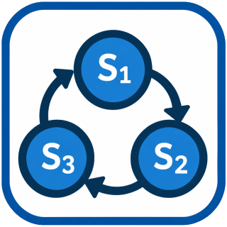
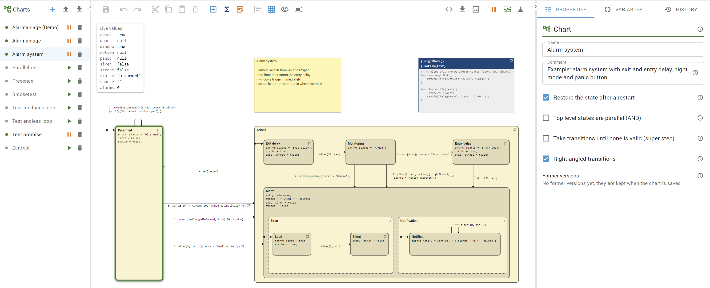

# ioBroker.statechart

**Tests:** 

**English** | [Deutsch](docs/de/README.md)

## State machine adapter for ioBroker

Model your automations as **state machines** (statecharts) in a graphical editor, similar to the
chart editors known from model based development. States, transitions with events, conditions and
actions, timers and function blocks are drawn in the ioBroker admin and executed by the adapter.

*An alarm system as example: exit and entry delay, alarm with siren and notification in parallel, the live values
of the running chart on the top left, the variables on the right.*

### Features

- Graphical editor as its own entry in the admin side bar
- States with `entry`, `during` and `exit` actions, nested and parallel states (AND), history junction
- Transitions with labels in the well-known syntax `event[condition]{action}`
- Temporal logic like in Stateflow: `after(5, sec)`, `before`, `at`, `every`, counting inputs, `after(5, min, condition)`, `elapsed()`, `duration()`, and every day at a time or an astro event: `at("sunset", -30)`
- Function blocks with your own JavaScript functions, usable in all conditions and actions
- Inputs and outputs mapped to any ioBroker states
- Live view: the active state is highlighted in the editor, the current values of the variables are shown, taken
  transitions light up, and a history shows when which transition was taken and why
- Simulation: run the chart from the editor without switching anything, set the inputs by hand, advance the time,
  breakpoints and single steps
- Code editor with syntax highlighting, error checking (e.g. unknown variables) and completion
- Static check of the chart: states which never become active, transitions which are never taken, unused variables
- Several independent charts per instance, which can be paused, reset and woken up by states (e.g. from vis)
- Import and export of charts as JSON files, export of the whole chart as PNG image (e.g. for the forum)
- The last 10 versions of each chart are kept when it is saved, and can be restored
- Comments on states, transitions and function blocks, notes on the canvas, and a color per state
- States and transitions can be disabled, like commented out: they stay in the chart, but are not executed
- Per input: wake up on every update or only on changes, filter by ack, debounce
- Helper functions: getState (any state), setState, setStateDelayed, sendTo, isTimeBetween, isDaytime, astroTime, change detection (hasChanged...)
- Align and distribute the selected elements, give them the same width or height, snap to the grid (can be switched
  off, the grid can be hidden), show the whole chart with one click
- The list of charts and the properties panel can be resized and collapsed, for more space for the chart
- Undo/redo (Ctrl+Z, Ctrl+Y), cut/copy/paste/delete of states, function blocks and notes (Ctrl+X, Ctrl+C, Ctrl+V, Del), also between charts, saving with Ctrl+S, and a warning about unsaved changes
- **Show code**: the JavaScript generated from the chart, showing exactly how the adapter executes it

### Installation

The adapter is in the beta repository (latest). Select it in the admin under **Settings** → **Repositories**, then
install the adapter **Statechart** in the tab **Adapters** and add an instance. Until 1.0, the format of the charts
may still change.

Requirements: Node.js 22 or newer, js-controller 6.0.11 or newer, admin 7.6.20 or newer.

### Getting started

1. Open **Statechart** in the admin side bar.
2. Create a chart with **+** in the list on the left. Choose a **template** to start with a working example (light
   with motion detector, heating with window contact, alarm system, washing machine done, shutter with automatic and
   manual mode, push button with short, long and double press, presence), or an empty chart.
3. Define the variables in the tab **Variables** on the right, with **+** next to their group. The variables are
   grouped by kind, each one is a line with its state and current value, a click on it shows its settings:
   - **Input**: read from an ioBroker state, every change wakes up the chart
   - **Output**: written to an ioBroker state when an action changes it
   - **Local**: only exists inside the chart, with an initial value
4. Add states with **Add state**. The state marked with the dot and arrow is the initial state
   (can be changed in the properties of a state).
5. Draw transitions by dragging from the border of a state to another state (or to itself). The arrows start and
   end where the states face each other and follow them when they are moved. To fix an end at another place,
   select the transition and drag the round grip at the end along the border (double click: automatic again). To
   move a transition to another state, drop the grip on that state: its label and all other properties are kept.
   Drag a label to move it, e.g. if it covers another one; a moved label stays connected to its arrow by a thin line.
6. Select a state or transition (or double click it) to edit its actions or label on the right.
7. Click **Save**. New charts are paused: start the chart with ▶ in the chart list or in the toolbar. After saving, the adapter
   restarts a running chart immediately.

### Example: light with motion detector

| Variable | Scope | State |
|---|---|---|
| `motion` | Input | e.g. `hm-rpc.0.ABC123.1.MOTION` |
| `light` | Output | e.g. `hue.0.hallway.on` |

| State | entry |
|---|---|
| Off (initial state) | `light = false;` |
| On | `light = true;` |

| Transition | Label |
|---|---|
| Off → On | `motion[motion == true]` |
| On → Off | `after(2, min, !motion)` |

The light goes on with motion and off after 2 minutes without motion: `after(2, min, !motion)` waits until
`motion` has been false for 2 minutes, every new motion starts the time again.

### Documentation

- [Reference](docs/en/reference.md): the editor and its toolbar, transition labels and temporal logic, when inputs wake up the chart, actions,
  nested and parallel states, helper functions, function blocks, watching a running chart, simulation, import and
  export, states created by the adapter, restart, execution model and limitations
- [Development](docs/en/development.md): build, dev-server, tests and the structure of the project

## Disclaimer

MATLAB and Stateflow are registered trademarks of The MathWorks, Inc. This adapter is not affiliated
with, endorsed or sponsored by The MathWorks, Inc.

## Changelog
<!--
    Placeholder for the next version (at the beginning of the line):
    ### **WORK IN PROGRESS**
-->
### 0.7.2 (2026-11-24)
* (IggePop) saving a chart in the editor without changing its logic, e.g. after moving states or editing comments, no longer restarts it in its initial state: it continues where it was, like after a restart of the adapter
* (IggePop) the points to drag a new transition from only appear over a state, while it is selected or while a transition is dragged, and they are larger, like the handles to resize

### 0.7.1 (2026-11-22)
* (IggePop) the adapter and its tab in the admin are called "Statechart" in all languages
* (IggePop) fixed: a state of the adapter which could not be written, e.g. while it stops, caused an unhandled rejection
* (IggePop) unused translations removed, a missing Polish translation added

### 0.7.0 (2026-11-21)
* (IggePop) four new templates: washing machine done, shutter with automatic and manual mode, push button with short, long and double press, presence
* (IggePop) a paused chart keeps showing its last active states and values in the editor, gray and with their time, to help with debugging. The states `activeStateIds` and `values` keep the last values when a chart is paused, `activeState` is still cleared
* (IggePop) menu "View" in the toolbar: show or hide the grid, the minimap and the zoom buttons
* (IggePop) Ctrl+S saves the chart, also while typing in a field or code editor
* (IggePop) larger fields for transition labels (5 lines) and the actions of states (3 lines)
* (IggePop) the name of the adapter in all languages without translation errors, documentation of branching with priorities

### 0.6.0 (2026-11-19)
* (IggePop) the details of a variable list where it is used (states, transitions, function blocks), a click shows the element
* (IggePop) the wake up options of an input are always collapsed at first, the button shows if they are customized
* (IggePop) a chart whose code does not finish within the time limit of 1 s (e.g. an endless loop) is stopped, so it cannot block the other charts again and again
* (IggePop) a chart which writes more than 1000 times per minute (e.g. a feedback loop) is stopped
* (IggePop) the explanation of the transition label shows conditions with variables and a complete example
* (IggePop) new state `charts.<id>.error` with the last error or warning of a chart, e.g. to show it in vis
* (IggePop) the longer explanations behind the ⓘ icons are split into paragraphs, so they are easier to read
* (IggePop) fixed: an exception in a promise of the code of a chart restarted the adapter, and an endless loop in a promise was not aborted
* (IggePop) fixed: with the modern themes of admin 8 (also with the automatic theme), the editor stayed light instead of following the theme of the admin

### 0.5.1 (2026-11-15)
* (IggePop) documentation updated: active states, tooltips on tap, start and pause in the toolbar, the new layout functions
* (IggePop) the types of ioBroker are a direct development dependency (finding W048 of the repository checker)

Older changes: [CHANGELOG_OLD.md](CHANGELOG_OLD.md)

## License
MIT License

Copyright (c) 2026 IggePop <mail@igge.org>

Permission is hereby granted, free of charge, to any person obtaining a copy
of this software and associated documentation files (the "Software"), to deal
in the Software without restriction, including without limitation the rights
to use, copy, modify, merge, publish, distribute, sublicense, and/or sell
copies of the Software, and to permit persons to whom the Software is
furnished to do so, subject to the following conditions:

The above copyright notice and this permission notice shall be included in all
copies or substantial portions of the Software.

THE SOFTWARE IS PROVIDED "AS IS", WITHOUT WARRANTY OF ANY KIND, EXPRESS OR
IMPLIED, INCLUDING BUT NOT LIMITED TO THE WARRANTIES OF MERCHANTABILITY,
FITNESS FOR A PARTICULAR PURPOSE AND NONINFRINGEMENT. IN NO EVENT SHALL THE
AUTHORS OR COPYRIGHT HOLDERS BE LIABLE FOR ANY CLAIM, DAMAGES OR OTHER
LIABILITY, WHETHER IN AN ACTION OF CONTRACT, TORT OR OTHERWISE, ARISING FROM,
OUT OF OR IN CONNECTION WITH THE SOFTWARE OR THE USE OR OTHER DEALINGS IN THE
SOFTWARE.
