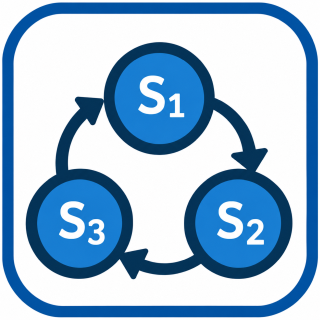

# ioBroker.statechart

[](https://www.npmjs.com/package/iobroker.statechart)
[](https://www.npmjs.com/package/iobroker.statechart)


[](https://nodei.co/npm/iobroker.statechart/)

**Tests:** 

**English** | [Deutsch](docs/de/README.md)

## State machine adapter for ioBroker

Model your automations as **state machines** (statecharts) in a graphical editor, similar to the
chart editors known from model based development. States, transitions with events, conditions and
actions, timers and function blocks are drawn in the ioBroker admin and executed by the adapter.

### Features

- Graphical editor as its own entry in the admin side bar
- States with `entry`, `during` and `exit` actions, nested and parallel states (AND), history junction
- Transitions with labels in the well-known syntax `event[condition]{action}`
- Temporal logic like in Stateflow: `after(5, sec)`, `before`, `at`, `every`, counting inputs, `after(5, min, condition)`, `elapsed()`, `duration()`, and every day at a time or an astro event: `at("sunset", -30)`
- Function blocks with your own JavaScript functions, usable in all conditions and actions
- Inputs and outputs mapped to any ioBroker states
- Live view: the active state is highlighted in the editor, the current values of the variables are shown, taken
  transitions light up, and a history shows when which transition was taken and why
- Simulation: run the chart from the editor without switching anything, set the inputs by hand, advance the time,
  breakpoints and single steps
- Code editor with syntax highlighting, error checking (e.g. unknown variables) and completion
- Static check of the chart: states which never become active, transitions which are never taken, unused variables
- Several independent charts per instance, which can be paused, reset and woken up by states (e.g. from vis)
- Import and export of charts as JSON files
- Comments on states, transitions and function blocks, and notes on the canvas
- Per input: wake up on every update or only on changes, filter by ack, debounce
- Helper functions: getState (any state), setState, setStateDelayed, sendTo, isTimeBetween, isDaytime, astroTime, change detection (hasChanged...)
- Align and distribute the selected elements
- Undo/redo (Ctrl+Z, Ctrl+Y), copy/cut/paste of states and function blocks (Ctrl+C, Ctrl+X, Ctrl+V), also between charts, and a warning about unsaved changes
- **Show code**: the JavaScript generated from the chart, showing exactly how the adapter executes it

### Installation

The adapter is not in the ioBroker repositories yet, but can be installed directly from GitHub:

- **Admin:** tab **Adapters** → icon **Install from custom URL** (GitHub cat) → tab **Custom** →
  URL `https://github.com/IggePop/ioBroker.statechart` → **Install**
- **or on the console** of the ioBroker system:
  ```bash
  iobroker url https://github.com/IggePop/ioBroker.statechart
  ```

Then add an instance of **State Machine**. This installs the current development version, which may
still change incompatibly.

Requirements: Node.js 22 or newer, js-controller 6.0.11 or newer, admin 7.6.17 or newer.

### Getting started

1. Open **State Machine** in the admin side bar.
2. Create a chart with **+** in the list on the left.
3. Define the variables in the tab **Variables** on the right, with **+** next to their group. The variables are
   grouped by kind, each one is a line with its state and current value, a click on it shows its settings:
   - **Input**: read from an ioBroker state, every change wakes up the chart
   - **Output**: written to an ioBroker state when an action changes it
   - **Local**: only exists inside the chart, with an initial value
4. Add states with **Add state**. The state marked with the dot and arrow is the initial state
   (can be changed in the properties of a state).
5. Draw transitions by dragging from the border of a state to another state (or to itself). The arrows start and
   end where the states face each other and follow them when they are moved. To fix an end at another place,
   select the transition and drag the round grip at the end along the border (double click: automatic again). To
   move a transition to another state, drop the grip on that state: its label and all other properties are kept.
   Drag a label to move it, e.g. if it covers another one; a moved label stays connected to its arrow by a thin line.
6. Select a state or transition (or double click it) to edit its actions or label on the right.
7. Click **Save**. New charts are paused: start the chart with ▶ in the chart list. After saving, the adapter
   restarts a running chart immediately.

### Example: light with motion detector

| Variable | Scope | State |
|---|---|---|
| `motion` | Input | e.g. `hm-rpc.0.ABC123.1.MOTION` |
| `light` | Output | e.g. `hue.0.hallway.on` |

| State | entry |
|---|---|
| Off (initial state) | `light = false;` |
| On | `light = true;` |

| Transition | Label |
|---|---|
| Off → On | `motion[motion == true]` |
| On → Off | `after(2, min, !motion)` |

The light goes on with motion and off after 2 minutes without motion: `after(2, min, !motion)` waits until
`motion` has been false for 2 minutes, every new motion starts the time again.

### Documentation

- [Reference](docs/en/reference.md): transition labels and temporal logic, when inputs wake up the chart, actions,
  nested and parallel states, helper functions, function blocks, watching a running chart, simulation, import and
  export, states created by the adapter, restart, execution model and limitations
- [Development](docs/development.md): build, dev-server, tests and the structure of the project

## Disclaimer

MATLAB and Stateflow are registered trademarks of The MathWorks, Inc. This adapter is not affiliated
with, endorsed or sponsored by The MathWorks, Inc.

## Changelog
<!--
    Placeholder for the next version (at the beginning of the line):
    ### **WORK IN PROGRESS**
-->
### **WORK IN PROGRESS**
* (Igge) simulation: advance the time (e.g. to the next timer), pause, single steps and breakpoints on states and transitions
* (Igge) simulation: the chart runs as shown in the editor without writing outputs, the inputs are set by hand
* (Igge) `getState("id")` reads any state in conditions and actions, `at("sunset", -30)` and `at("22:30")` are valid every day at an astro event or a time of day
* (Igge) control states per chart: `enabled` pauses and starts it, `reset` restarts it in its initial state, `event` wakes it up with the event of an input
* (Igge) more temporal logic: `before`, `at` and `every`, counting the wakeups by an input (`after(3, button)`), `after(5, min, condition)` for conditions which are true for a time, and the helpers `elapsed()` and `duration()`
* (Igge) the variables are grouped by kind and shown as compact lines, a click shows the settings of a variable, a search appears with many variables
* (Igge) the labels of transitions can be moved by dragging them
* (Igge) align and distribute the selected states, function blocks and notes
* (Igge) static check of the chart: states which never become active or are never left, transitions which are never taken, conditions which are never true, unused variables
* (Igge) history junction: entering a state returns to its last active sub state
* (Igge) parallel states (AND): all sub states of a state, or all top level states, are active at the same time and are processed in their execution order

### 0.2.0 (2026-11-01)
* (Igge) the adapter and the editor are written in TypeScript now, no changes of the behavior
* (Igge) live values of the variables in the editor
* (Igge) taken transitions light up in the editor
* (Igge) history of the starts and the transitions taken (tab "History", state `charts.<chart>.history`)
* (Igge) a chart wakes up once right after the start, so transitions without label are taken without waiting for a change of an input
* (Igge) chart option "super step": take transitions until none is valid anymore
* (Igge) the arrows of transitions start and end where the states face each other (floating edges), their ends can be dragged along the border of the states or onto another state to move the transition there
* (Igge) change detection: `hasChanged`, `hasChangedFrom` and `hasChangedTo`, e.g. `hasChangedTo(button, true)` for edges
* (Igge) suncalc 2: `isDaytime()` is true all day during the midnight sun, `astroTime()` reports events which do not happen on a day (polar regions)

### 0.1.1 (2026-10-25)
* (Igge) renamed from "state-machine" to "statechart", because npm does not accept the old name (too similar to an existing package)

### 0.1.0 (2026-10-25)
* (Igge) initial release
* (Igge) graphical chart editor in the admin side bar: states, transitions, nested states, function blocks, notes
* (Igge) transition labels in Stateflow syntax event[condition]{action}, timers with after(n, unit)
* (Igge) execution with Stateflow semantics (outer before inner transitions, inner transitions)
* (Igge) charts continue in their state after a restart of the adapter
* (Igge) per input: wake up on updates or changes, filter by ack, debounce
* (Igge) helper functions: setState, setStateDelayed, sendTo, isTimeBetween, isDaytime, astroTime
* (Igge) code editor with syntax highlighting, error checks and completion, generated code view
* (Igge) undo/redo, copy/paste, import/export of charts as JSON

## License
MIT License

Copyright (c) 2026 Igge <mail@igge.org>

Permission is hereby granted, free of charge, to any person obtaining a copy
of this software and associated documentation files (the "Software"), to deal
in the Software without restriction, including without limitation the rights
to use, copy, modify, merge, publish, distribute, sublicense, and/or sell
copies of the Software, and to permit persons to whom the Software is
furnished to do so, subject to the following conditions:

The above copyright notice and this permission notice shall be included in all
copies or substantial portions of the Software.

THE SOFTWARE IS PROVIDED "AS IS", WITHOUT WARRANTY OF ANY KIND, EXPRESS OR
IMPLIED, INCLUDING BUT NOT LIMITED TO THE WARRANTIES OF MERCHANTABILITY,
FITNESS FOR A PARTICULAR PURPOSE AND NONINFRINGEMENT. IN NO EVENT SHALL THE
AUTHORS OR COPYRIGHT HOLDERS BE LIABLE FOR ANY CLAIM, DAMAGES OR OTHER
LIABILITY, WHETHER IN AN ACTION OF CONTRACT, TORT OR OTHERWISE, ARISING FROM,
OUT OF OR IN CONNECTION WITH THE SOFTWARE OR THE USE OR OTHER DEALINGS IN THE
SOFTWARE.
