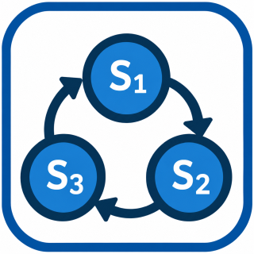
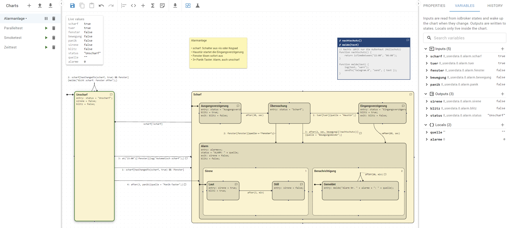

# ioBroker.statechart

[English](../../README.md) | **Deutsch**

## Zustandsautomaten-Adapter für ioBroker

Bilde deine Automatisierungen als **Zustandsautomaten** (Statecharts) in einem grafischen Editor ab,
ähnlich den Chart-Editoren aus der modellbasierten Entwicklung. Zustände, Übergänge mit Events,
Bedingungen und Aktionen, Timer und Funktionsblöcke werden im ioBroker-Admin gezeichnet und vom
Adapter ausgeführt.



*Eine Alarmanlage als Beispiel: Ausgangs- und Eingangsverzögerung, Alarm mit Sirene und Benachrichtigung parallel,
oben links die Live-Werte des laufenden Charts, rechts die Variablen.*

### Funktionen

- Grafischer Editor als eigener Eintrag in der Seitenleiste des Admins
- Zustände mit `entry`-, `during`- und `exit`-Aktionen, verschachtelte und parallele Zustände (UND), History-Junction
- Übergänge mit Beschriftungen in der bekannten Syntax `event[bedingung]{aktion}`
- Zeitlogik wie bei Stateflow: `after(5, sec)`, `before`, `at`, `every`, Zählen von Eingängen, `after(5, min, bedingung)`, `elapsed()`, `duration()`, und jeden Tag zu einer Uhrzeit oder einem Astro-Ereignis: `at("sunset", -30)`
- Funktionsblöcke mit eigenen JavaScript-Funktionen, nutzbar in allen Bedingungen und Aktionen
- Eingänge und Ausgänge, die mit beliebigen ioBroker-Datenpunkten verbunden sind
- Live-Ansicht: Der aktive Zustand wird im Editor hervorgehoben, die aktuellen Werte der Variablen werden angezeigt,
  genommene Übergänge leuchten auf, und ein Verlauf zeigt, wann welcher Übergang genommen wurde und warum
- Simulation: das Chart aus dem Editor laufen lassen, ohne dass etwas geschaltet wird, Eingänge von Hand setzen, Zeit
  vorspulen, Haltepunkte und Einzelschritte
- Code-Editor mit Syntax-Hervorhebung, Fehlerprüfung (z.B. unbekannte Variablen) und Autovervollständigung
- Statische Prüfung des Charts: Zustände, die nie aktiv werden, Übergänge, die nie genommen werden, ungenutzte Variablen
- Mehrere unabhängige Charts pro Instanz, die sich über Datenpunkte anhalten, zurücksetzen und wecken lassen (z.B. aus vis)
- Import und Export von Charts als JSON-Dateien, Export des ganzen Charts als PNG-Bild (z.B. fürs Forum)
- Kommentare zu Zuständen, Übergängen und Funktionsblöcken, Notizen auf der Zeichenfläche und eine Farbe pro Zustand
- Pro Eingang: Aufwecken bei jeder Aktualisierung oder nur bei Änderung, Filter nach ack, Entprellen
- Hilfsfunktionen: getState (beliebige Datenpunkte), setState, setStateDelayed, sendTo, isTimeBetween, isDaytime, astroTime, Änderungserkennung (hasChanged...)
- Ausgewählte Elemente ausrichten und verteilen, Einrasten am Raster (abschaltbar)
- Die Chart-Liste und die Eigenschaften lassen sich in der Breite ändern und einklappen, für mehr Platz für das Chart
- Rückgängig/Wiederholen (Strg+Z, Strg+Y), Kopieren/Ausschneiden/Einfügen von Zuständen und Funktionsblöcken (Strg+C, Strg+X, Strg+V), auch zwischen Charts, und eine Warnung bei ungespeicherten Änderungen
- **Code anzeigen**: das aus dem Chart generierte JavaScript, das genau zeigt, wie der Adapter es ausführt

### Installation

Der Adapter ist noch nicht in den ioBroker-Repositories, lässt sich aber direkt von GitHub installieren:

- **Admin:** Reiter **Adapter** → Symbol **Aus eigener URL installieren** (GitHub-Katze) → Reiter
  **Benutzerdefiniert** → URL `https://github.com/IggePop/ioBroker.statechart` → **Installieren**
- **oder auf der Konsole** des ioBroker-Systems:
  ```bash
  iobroker url https://github.com/IggePop/ioBroker.statechart
  ```

Danach eine Instanz von **Zustandsmaschine** hinzufügen. Installiert wird der aktuelle
Entwicklungsstand, der sich noch inkompatibel ändern kann.

Voraussetzungen: Node.js 22 oder neuer, js-controller 6.0.11 oder neuer, Admin 7.6.17 oder neuer.

### Erste Schritte

1. In der Seitenleiste des Admins **Zustandsmaschine** öffnen.
2. Links in der Liste mit **+** ein Chart anlegen.
3. Rechts im Reiter **Variablen** die Variablen festlegen, mit **+** neben ihrer Gruppe. Die Variablen sind nach Art
   gruppiert, jede ist eine Zeile mit ihrem Datenpunkt und aktuellen Wert, ein Klick darauf zeigt ihre Einstellungen:
   - **Eingang**: wird aus einem ioBroker-Datenpunkt gelesen, jede Änderung weckt das Chart auf
   - **Ausgang**: wird in einen ioBroker-Datenpunkt geschrieben, wenn eine Aktion ihn ändert
   - **Lokal**: gibt es nur im Chart, mit einem Startwert
4. Mit **Zustand hinzufügen** Zustände anlegen. Der Zustand mit Punkt und Pfeil ist der Startzustand
   (änderbar in den Eigenschaften eines Zustands).
5. Übergänge zeichnen: vom Rand eines Zustands zu einem anderen Zustand (oder zu sich selbst) ziehen. Die Pfeile
   beginnen und enden dort, wo sich die Zustände gegenüberliegen, und folgen ihnen beim Verschieben. Um ein Ende
   an einer anderen Stelle festzulegen, den Übergang auswählen und den runden Griff am Ende am Rand entlang ziehen
   (Doppelklick: wieder automatisch). Um einen Übergang an einen anderen Zustand umzuhängen, den Griff auf diesen
   Zustand ziehen: Beschriftung und alle anderen Eigenschaften bleiben erhalten. Eine Beschriftung lässt sich
   verschieben, z.B. wenn sie eine andere verdeckt; eine verschobene Beschriftung bleibt durch eine dünne Linie mit
   ihrem Pfeil verbunden.
6. Einen Zustand oder Übergang anklicken (oder doppelklicken), um rechts seine Aktionen bzw. seine
   Beschriftung zu bearbeiten.
7. **Speichern** klicken. Neue Charts sind angehalten: Starte das Chart mit ▶ in der Chart-Liste. Nach dem
   Speichern startet der Adapter ein laufendes Chart sofort neu.

### Beispiel: Licht mit Bewegungsmelder

| Variable | Art | Datenpunkt |
|---|---|---|
| `motion` | Eingang | z.B. `hm-rpc.0.ABC123.1.MOTION` |
| `light` | Ausgang | z.B. `hue.0.flur.on` |

| Zustand | entry |
|---|---|
| Aus (Startzustand) | `light = false;` |
| An | `light = true;` |

| Übergang | Beschriftung |
|---|---|
| Aus → An | `motion[motion == true]` |
| An → Aus | `after(2, min, !motion)` |

Das Licht geht bei Bewegung an und nach 2 Minuten ohne Bewegung aus: `after(2, min, !motion)` wartet, bis
`motion` 2 Minuten lang falsch ist, jede neue Bewegung startet die Zeit neu.

### Dokumentation

- [Referenz](reference.md): Beschriftung von Übergängen und Zeitlogik, wann Eingänge das Chart aufwecken, Aktionen,
  verschachtelte und parallele Zustände, Hilfsfunktionen, Funktionsblöcke, ein laufendes Chart beobachten,
  Simulation, Import und Export, vom Adapter angelegte Datenpunkte, Neustart, Ausführung und Einschränkungen
- [Entwicklung](../development.md) (Englisch): Build, Dev-Server, Tests und Aufbau des Projekts

### Hinweis

MATLAB und Stateflow sind eingetragene Marken von The MathWorks, Inc. Dieser Adapter steht in keiner Verbindung
zu The MathWorks, Inc. und wird von ihr weder unterstützt noch gesponsert.

Den Changelog gibt es im [englischen README](../../README.md#changelog).
